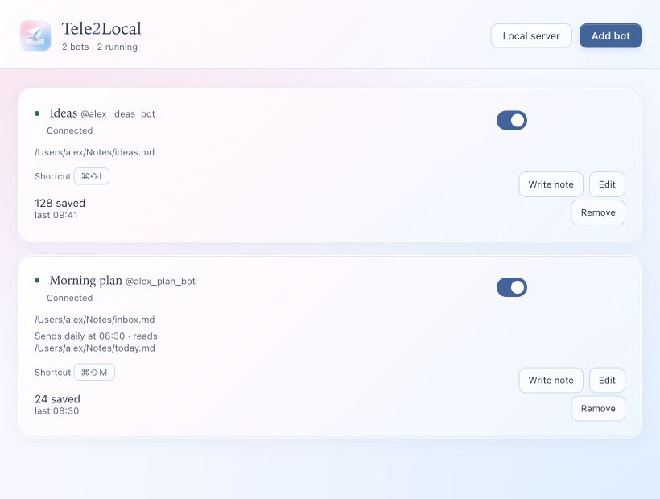
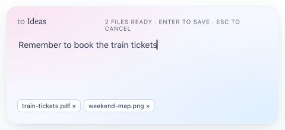
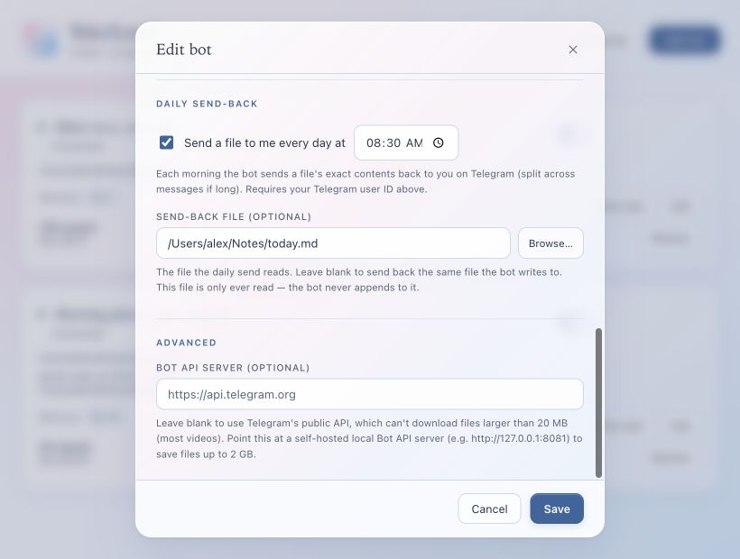

# Tele2Local

Version **1.0.0** · Light pink-and-blue glass theme.

**Save messages and files now. Process them together later.**

Send text, photos, documents, and other files to your Telegram bot. Tele2Local appends messages to a local Markdown log and downloads attachments to a folder you choose, recording their paths in the log. It runs in your Mac’s menu bar or Windows system tray.

## Capture first, process later

Sometimes you just want to save something and get on with your day. Sending every item directly to an agent can start a conversation or processing task before you are ready. Tele2Local gives you a local inbox: collect the raw material throughout the day, then let an agent or script work through the whole batch when you choose.

For example, save daily updates, receipt photos, and reference files as they arrive. At midnight, a separately scheduled agent can read the day’s log and its attachments, summarize what happened, extract tasks, and organize the files—with the day’s context available together.

- **During the day:** messages + files → local log + attachment folder
- **At midnight:** your scheduled agent or script → summary, tasks, or archive

Tele2Local handles capture and storage. Agent processing and its schedule are configured separately; the built-in **Daily send-back** only sends a text file’s contents to you in Telegram.

No separate notes account or hosted backend is needed. Telegram captures still travel through Telegram; the saved messages and files live on your computer.

| Capture | What happens |
| --- | --- |
| **Message your bot** | Text is appended with a timestamp. |
| **Send a photo or file** | The attachment is downloaded, with its path recorded in your note. |
| **Write locally** | Click **Write note** or press a global shortcut; type or drop files, then Enter. |
| **Get a daily reminder** | A bot sends a chosen text file’s contents back to you at a set time. |



*Screenshots show the actual frontend with fictional demo data. They do not show live Telegram traffic.*

## Get started

### 1. Open the app

This source release builds **Tele2Local 1.0.0**. Follow the [build instructions](docs/development.md) to create an application or installer for your platform.

| Platform target | Install / open |
| --- | --- |
| **macOS 11 Big Sur+ · Intel & Apple Silicon** | Open the `.dmg`, move Tele2Local to Applications, then launch it. |
| **Windows 10/11 · x64 Intel/AMD** | Run the `*-setup.exe`. Setup downloads WebView2 if missing. |

**Verification:** Intel and Apple Silicon executables build with a macOS 11.0 minimum. Windows support and installer automation are implemented, but the full Windows installer and an on-device Big Sur launch are not yet verified. Windows ARM64 and 32-bit Windows are not targeted.

The manager opens automatically when no bots are configured. Later, choose **Open Manager** from the menu bar or tray icon. On Windows, check the hidden-icons arrow if needed.

### 2. Connect a bot to a file

1. In Telegram, message **@BotFather**, use `/newbot`, and copy the token.
2. Get **your numeric Telegram user ID** from **@userinfobot**.
3. In Tele2Local, click **Add bot**. Enter a name, token, and your user ID.
4. Click **Validate token**. Choose **New file…** for a new note, or **Browse…** for an existing one. Leave **Enabled** checked and save.

Use your own user ID for private capture. Entering `0` explicitly lets anyone who finds the bot write to your file.

### 3. Save a message and a file

Open your new bot’s private chat in Telegram, tap **Start**, and send a short message. A 👍 reaction confirms it was saved. Click the file path in Tele2Local to read it:

```markdown
- [2026-09-27 09:41] Remember to book the train tickets
```

Send a photo or document to the same bot. Tele2Local downloads the actual file and adds its saved path to the log. A **✅ Saved** reply confirms the download finished. Set **Files folder** when adding or editing the bot, or leave it blank to use `attachments` beside the log. See [file-size limits](docs/usage.md#large-attachments-optional-local-bot-api-server).

Keep Tele2Local running on a computer that is awake and online. Closing the manager hides it; **Quit Tele2Local** stops capture. [Launch at login and troubleshooting →](docs/usage.md)

## Capture without opening Telegram

Click **Write note** beside any configured bot. Type a note or drop files, then press **Enter**. Use **Shift+Enter** for a new line; **Esc** discards the current draft. Click an attachment’s **×** to remove only that file.



For faster access, set **Edit → Local shortcut → Record**. It works even when Telegram polling is paused. Drafts survive switching bots while the app runs; they are not saved across an app restart. Dropped files are copied, leaving the originals untouched.

## Send a file back to yourself each day

In **Edit → Daily send-back**, enable the schedule and choose a local time. Leave **Send-back file** blank to read the same note the bot writes, or choose another existing text file. Your user ID must be set, the bot enabled, and the app running.



Empty files are skipped. Long files are split across messages. Starting after the scheduled time does not trigger a catch-up send. [Details and file-size limits →](docs/usage.md)

## Your data

- **Notes and attachments:** ordinary files in folders you choose. Default attachment folder: `attachments` beside the note.
- **Tokens:** macOS Keychain or Windows Credential Manager; never written into `bots.json`.
- **Settings:** `~/Library/Application Support/com.notekeeper.desktop/` on Mac; `%APPDATA%\com.notekeeper.desktop\` on Windows.
- **Removing a bot:** stops capture and removes its configuration; existing notes and attachments remain.

[Usage & troubleshooting](docs/usage.md) · [Build & development](docs/development.md) · [Security](SECURITY.md)

## Rights

Copyright © 2026. All rights reserved. No licence is granted. Use, copying, modification, distribution, or derivative works require prior written permission from the copyright holder. Third-party dependencies retain their own licences.

## Automatic downloads

Every successful build from a push to `main` refreshes the public **1.0.0** release.
All required platform builds and checks must pass first. Downloads use
`Tele2Local-1.0.0-OS-architecture.ext`:
`Tele2Local-1.0.0-macOS-universal.dmg` or `Tele2Local-1.0.0-Windows-x64.exe`,
alongside `Tele2Local-1.0.0-source.zip` and `SHA256SUMS.txt`. See [release
automation](.github/RELEASES.md) for the exact packages, checksums, and retry behavior.
